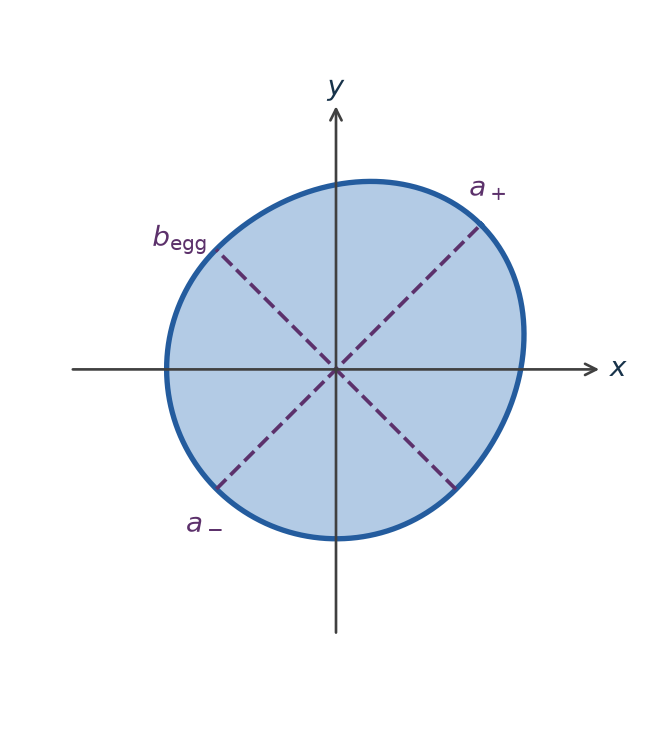
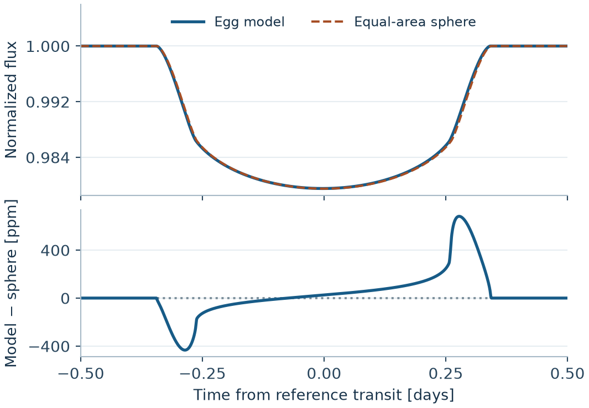

# Egg model

`egg_lc` models an opaque silhouette made of two half-ellipses joined along a shared vertical axis. Use it to give the two sides of the planet different widths while keeping the full silhouette height fixed.

| Shape input | Meaning |
| --- | --- |
| `a_p` | Semi-axis of the right half-ellipse along the planet's local x-axis. |
| `a_m` | Semi-axis of the left half-ellipse along the same axis. |
| `b_egg` | Shared vertical semi-axis. The full height is `2 * b_egg`, and the separate `impact` input controls the transit path. |
| `theta` | Counterclockwise rotation of the joined silhouette in radians. |

All three semi-axes must be strictly between zero and one in stellar-radius units. Setting `a_p = a_m` gives a full ellipse. With unequal halves, rotating the silhouette by 180° exchanges which half leads along a given transit direction.

## Example with Kepler-167e

Run the [shared setup](../models.md#kepler-167e-setup), then choose `a_p = 1.15 * r0`, `a_m = 0.95 * r0`, and `b_egg = r0 / 1.05`, with a 45° orientation. Adding the areas of the half-ellipses gives `A_egg = π * b_egg * (a_p + a_m) / 2`. The equivalent spherical radius is `sqrt(A_egg / π)` and equals `r0` for these inputs.

```python
model = "egg"
a_p, a_m, b_egg = 1.15 * r0, 0.95 * r0, r0 / 1.05
theta = np.deg2rad(45)

params = [
    tc, impact, period, a_p, a_m, b_egg, theta,
    ecc, omega, u1, u2, log10_rho_star,
]
flux, contacts = egg_lc(params, time, exp_time=exp_time)

rp_eff = np.sqrt(b_egg * (a_p + a_m) / 2)
sphere_params = [
    tc, impact, period, rp_eff, 0, 0,
    ecc, omega, u1, u2, log10_rho_star,
]
sphere_flux, _ = spherical_lc(sphere_params, time, exp_time=exp_time)
```

The egg call returns the normalized flux array and sampled contact times. The two zeros in `sphere_params` occupy the flattening and orientation slots of the spherical function's 11-element input. Use the [comparison plotting example](../models.md#compare-a-model-with-an-equal-area-sphere) to draw both views.

<div class="jojo-model-figures" markdown="block">

<figure markdown="span">

<figcaption>The dashed local x-axis shows the unequal left and right semi-axes, labeled a− and a+.</figcaption>
</figure>

<figure markdown="span">

<figcaption>The ppm panel shows the effect of the unequal halves, which change the region of the stellar disk covered at each time.</figcaption>
</figure>

</div>
