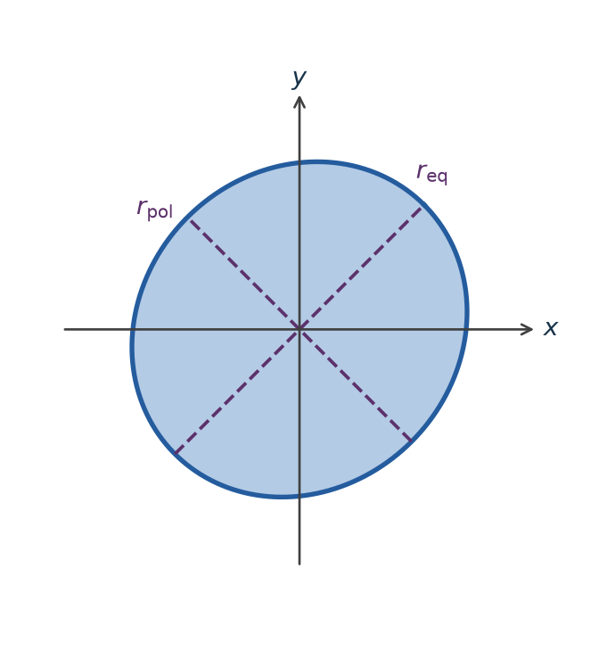
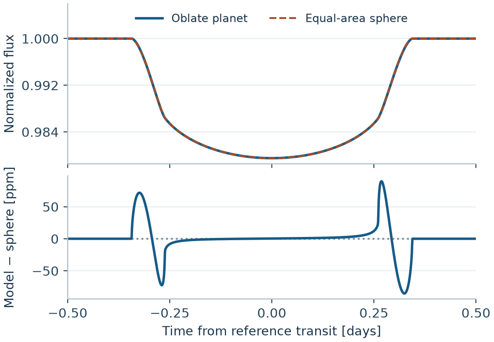
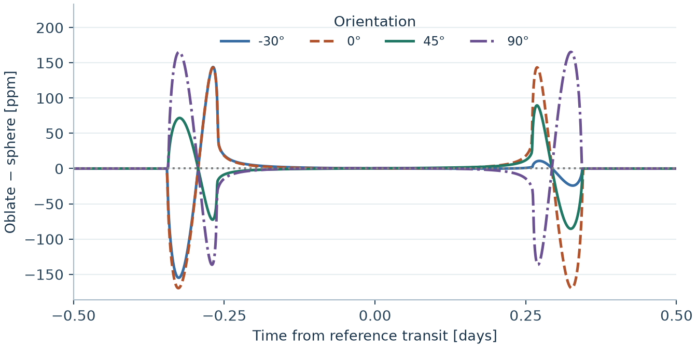

# Oblate model

`oblate_lc` models the planet as an opaque ellipse projected onto the sky. Use it to explore how projected flattening and orientation affect a transit light curve.

| Shape input | Meaning |
| --- | --- |
| `rp_me` | Radius of a sphere with the same projected area as the ellipse. |
| `f` | Projected flattening, `1 − r_pol / r_eq`, where `r_eq` and `r_pol` are the projected equatorial and polar semi-axes. Use `0 ≤ f < 1`. |
| `theta` | Counterclockwise angle in radians from the sky x-axis to the projected equatorial axis. The positive x-axis points along the transit. |

The ellipse has semi-axes `r_eq = rp_me / sqrt(1 - f)` and `r_pol = rp_me * sqrt(1 - f)`. Both are in stellar-radius units, and `r_eq` must be less than one.

## Example with Kepler-167e

After running the [shared setup](../models.md#kepler-167e-setup), set the flattening to 0.10 and the orientation to 45°. Pass the same 11-element vector to `spherical_lc` for the comparison. The spherical function uses `rp_me` as its radius and ignores the flattening and orientation entries.

```python
model = "oblate"
rp_me = r0
f, theta = 0.10, np.deg2rad(45)

params = [
    tc, impact, period, rp_me, f, theta,
    ecc, omega, u1, u2, log10_rho_star,
]
flux, contacts = oblate_lc(params, time, exp_time=exp_time)
sphere_flux, _ = spherical_lc(params, time, exp_time=exp_time)
```

Both calls return a flux array and a list of approximate contact times in days. Use the [comparison plotting example](../models.md#compare-a-model-with-an-equal-area-sphere) to reproduce the two views.

<div class="jojo-model-figures" markdown="block">

<figure markdown="span">

<figcaption>Projected ellipse at 45°. The dashed lines mark its equatorial and polar axes.</figcaption>
</figure>

<figure markdown="span">

<figcaption>The curves nearly coincide at full scale. The lower panel shows the shape signal in ppm, especially during ingress and egress.</figcaption>
</figure>

</div>

## Vary the orientation

With a nonzero impact parameter, tilting the ellipse changes how its leading and trailing edges cross the stellar limb. This example compares the notebook's four orientations at fixed radius and flattening. The equal-area spherical curve is the same in all four cases.

```python
fig, ax = plt.subplots(figsize=(7, 3.5), layout="constrained")
for angle_deg in (-30, 0, 45, 90):
    rotated_params = params.copy()
    rotated_params[5] = np.deg2rad(angle_deg)
    rotated_flux, _ = oblate_lc(rotated_params, time, exp_time=exp_time)
    ax.plot(time - tc, 1e6 * (rotated_flux - sphere_flux), label=f"{angle_deg}°")

ax.axhline(0, color="0.5", linestyle=":")
ax.set_xlabel("Time from reference transit [days]")
ax.set_ylabel("Oblate − sphere [ppm]")
ax.legend(title="Orientation")
plt.show()
```

{ .jojo-orientation-figure }

The light-curve model uses the spherical solution when `f * r_eq**2 < 1e-6`. If you fit or differentiate near a spherical shape, account for that switch when interpreting shape gradients.
