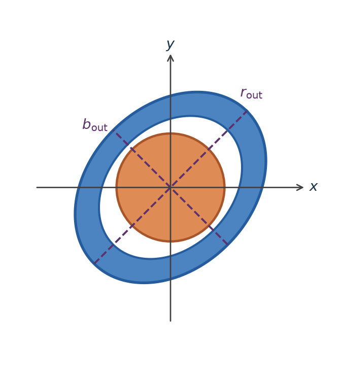
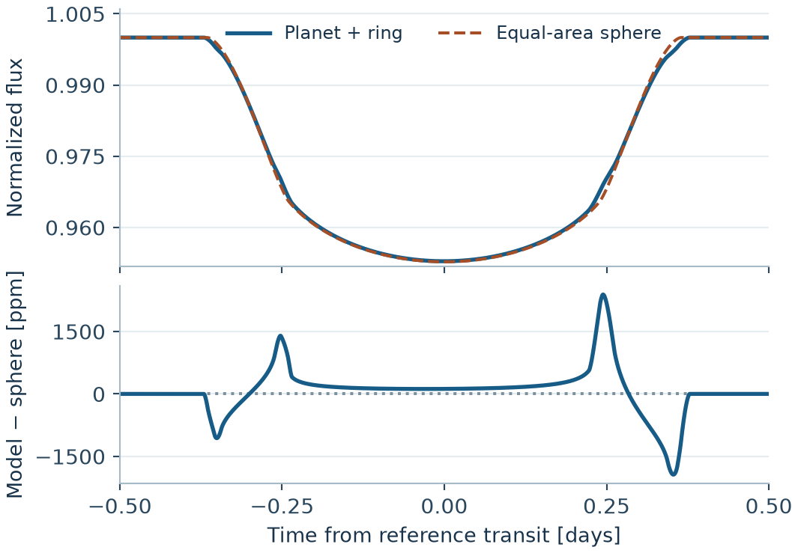

# Ring model

`ring_lc` models an opaque spherical planet plus a projected ring. The ring lies between two concentric ellipses with the same axis ratio and orientation.

| Shape input | Meaning |
| --- | --- |
| `r_p` | Radius of the opaque planet in stellar-radius units. |
| `r_in`, `r_out` | Inner and outer ring semi-major axes in stellar-radius units. Require `0 < r_p ≤ r_in ≤ r_out < 1`. |
| `f_r` | Projected flattening. Both ellipses have minor-to-major axis ratio `q = 1 - f_r`, with `0 ≤ f_r < 1`. |
| `theta` | Counterclockwise orientation of the ring's major axis in radians. |
| `alpha` | Fraction of incident starlight blocked by the projected ring outside the opaque planet. Use 0 for a transparent ring and 1 for an opaque ring. |

For a thin circular ring tilted by an angle `i_r` from face-on, the flattening input is `f_r = 1 - cos(i_r)`. A face-on ring has `f_r = 0`.

## Example with Kepler-167e

Run the [shared setup](../models.md#kepler-167e-setup), then add an opaque ring extending from 1.5 to 2 planet radii with flattening 0.25 and orientation 45°. The inner projected semi-minor axis `q * r_in` is larger than `r_p` here, so the opaque disk fits inside the projected hole. In this geometry the equal-area sphere has radius `sqrt(r_p**2 + q * (r_out**2 - r_in**2))`.

```python
model = "ring"
r_p = r0
r_in, r_out = 1.5 * r_p, 2.0 * r_p
f_r, theta, alpha = 0.25, np.deg2rad(45), 1.0
q = 1 - f_r

params = [
    tc, impact, period, r_p, r_in, r_out, f_r, theta,
    ecc, omega, u1, u2, log10_rho_star, alpha,
]
flux = ring_lc(params, time, exp_time=exp_time)

rp_eff = np.sqrt(r_p**2 + q * (r_out**2 - r_in**2))
sphere_params = [
    tc, impact, period, rp_eff, 0, 0,
    ecc, omega, u1, u2, log10_rho_star,
]
sphere_flux, _ = spherical_lc(sphere_params, time, exp_time=exp_time)
```

`ring_lc` returns a single flux array. Use the [comparison plotting example](../models.md#compare-a-model-with-an-equal-area-sphere) to draw the ring and the equal-area comparison.

<div class="jojo-model-figures" markdown="block">

<figure markdown="span">

<figcaption>The orange disk is the planet. The dashed lines mark the outer ring ellipse's two axes.</figcaption>
</figure>

<figure markdown="span">

<figcaption>The ring spreads its occulting area farther from the planet's center, changing the shape of ingress and egress.</figcaption>
</figure>

</div>

## Change opacity or geometry

Vary the last element of `params` to change how much light the ring blocks while leaving its geometry fixed. At `alpha = 0`, the curve is the transit of the bare planet of radius `r_p`. For a partially transparent ring with no planet–ring overlap, multiplying the annulus area term by `alpha` gives an attenuation-weighted area for a uniform background. If the projected ring overlaps the planet, compute only the part of the ring outside the opaque disk when estimating an equivalent area. The light-curve function accounts for this overlap internally.
